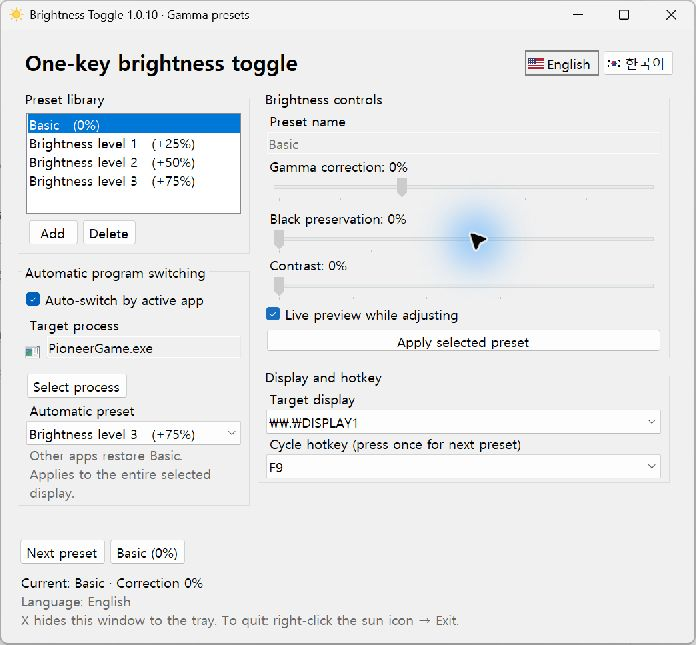

# Brightness Toggle

A lightweight Windows desktop utility for switching SDR screen gamma presets with one key. Brighten dark game scenes, tune black preservation and contrast, or apply a preset automatically while a chosen program is active. Built with C# and WinForms. Current version: **1.0.10**.

**[Download 1.0.10 for Windows x64](https://github.com/idlepoe/brightness_toggle/releases/download/v1.0.10/BrightnessToggle-1.0.10-win-x64.zip)** · [Release notes](https://github.com/idlepoe/brightness_toggle/releases/tag/v1.0.10) · [All releases](https://github.com/idlepoe/brightness_toggle/releases)

## Screenshot



The interface groups the preset library, brightness controls, automatic program switching, and display/hotkey settings. The example targets ARC Raiders (`PioneerGame.exe`); brightness correction affects the entire selected monitor while the game is active.

## Features

- Cycle Basic (0%), +25%, +50%, and +75% presets with F9; add your own presets.
- Adjust gamma correction, black preservation, and contrast with live preview.
- Automatically apply a chosen preset when a selected program is active; restore Basic after Alt+Tab or exit.
- Find processes by executable name or window title, including `ARC`, `Raiders`, and `PioneerGame.exe`. Process icons help identify applications.
- English by default, with an instant English/Korean switch and saved language preference.
- A corner notification, monitor selection, and system-tray controls.

## Download and run

1. Download [**BrightnessToggle-1.0.10-win-x64.zip**](https://github.com/idlepoe/brightness_toggle/releases/download/v1.0.10/BrightnessToggle-1.0.10-win-x64.zip).
2. Extract the ZIP and run **BrightnessToggle.exe**.
3. Select your display, then press **F9** to cycle through **Basic (0%)**, **Brightness level 1 (+25%)**, **Brightness level 2 (+50%)**, and **Brightness level 3 (+75%)**.

Windows 10/11 x64. No separate Java or .NET installation is required. The portable build opens no console window. Portable releases are unsigned, so Windows may display an unknown-publisher or SmartScreen warning. The default interface language is English. Use the US and South Korean flag buttons at the top of the window to switch between English and Korean. Your choice is saved.

## Presets and preview

- Select a preset in the list to edit it. Selection alone does not apply it.
- Click **Add** to create a preset and edit its name.
- Adjust the slider from **-50% to +100%** gamma correction.
- With **Live preview while adjusting** checked, slider changes apply immediately. Otherwise changes are saved without changing the screen.
- Click **Apply selected preset** to apply the selected preset.
- **Next preset** and the global hotkey cycle through the list.
- **Delete** removes the selected custom preset. The fixed default preset cannot be edited or deleted.

New installations include these starting points (gamma correction / black preservation / contrast):

| Preset | Gamma | Black preservation | Contrast |
|---|---:|---:|---:|
| Basic | 0% | 0% | 0% |
| Brightness level 1 | +25% | 15% | 5% |
| Brightness level 2 | +50% | 25% | 10% |
| Brightness level 3 | +75% | 35% | 15% |

Adjust **Gamma correction**, **Black preservation** (0–100%), and **Contrast** (0–50%) independently for each editable preset. Live preview applies all three together. Black preservation reduces the lifted, gray appearance of shadows; contrast separates dark and bright tones. Higher values can hide shadow details, so adjust while viewing the game. These are tone-curve strengths, not physical brightness measurements. Basic always restores the original gamma.

Legacy built-in +25%/+80% presets are replaced with the default stages once. Custom presets retain their names, correction amounts, and order after the new stages, with both new controls initially at zero. Edits and deletions are retained on subsequent starts. Built-in stage names follow the selected language until renamed.

## Interface language

Use the flag buttons in the upper-right corner: the US flag selects **English**, and the South Korean flag selects **한국어**. Switching updates the window, menus, notifications, and subsequent dialogs immediately. Preset names you entered are preserved. English is the default for new and legacy settings without a saved language.

## Automatic switching by active program

1. Start the game or program you want to target.
2. Click **Select process**. Search by process name or any visible window title (multiple search words are supported), select the actual game executable, then click **Select**. Search ignores invisible formatting characters and spacing in window titles. **Refresh** updates the running-process list. Alternatively, click **Pick active window (5 sec)** and switch to your game within five seconds; the foreground process is selected automatically. Programs with a window appear first.
3. Choose an **Automatic preset** and enable **Auto-switch by active app**. The feature is off by default.
4. The chosen preset applies when the target process owns the foreground window. Alt+Tab to another program, minimizing the target, or exiting it restores **Basic**. Detection runs approximately every 250 ms and continues while this utility is hidden to the tray.

One executable name is supported at a time; all instances with that name match, regardless of capitalization. The selection and preset are saved across restarts, even if the target is not running. Choose the game executable rather than its launcher. Some hosted applications share a process name and cannot be distinguished this way.

Automatic mode controls the entire selected monitor, not only pixels inside the program window. While automatic mode is enabled, editing sliders saves values but only applies them when the target is active. Disable automatic mode to use live preview in the settings window; disabling restores Basic first. The Apply button selects the automatic preset in this mode. F9 changes and remembers the automatic preset while the target is active; outside it, the screen stays at Basic. Automatic changes only apply when needed. Failed changes show an error and retry at most every five seconds.

## Hotkey and display

Choose a display under **Target display**. Changing the target restores the previous display first. Choose an F1–F11 hotkey under **Cycle hotkey**; the default is F9. Holding the key does not repeatedly cycle. If another program owns a hotkey, choose a different one.

A notification in the lower-right corner of the target display shows the preset name and correction amount for approximately 2.2 seconds without taking input focus.

## System tray and exit

**The X button hides the window to the system tray; it does not exit the application.** A persistent note and a notification explain this behavior.

- Look for the **yellow sun icon** near the Windows clock. It may be inside the hidden-icons menu.
- Double-click the icon to cycle to the next preset.
- Right-click → **Open settings** to reopen the window.
- Right-click → **Basic (0%)** to restore the original gamma.
- Right-click → **Exit (restore original gamma)** to fully exit.

Normal exit restores the original gamma tables. Forced termination may prevent restoration. Windows notification settings may suppress tray balloons.

## How brightness correction works

This app adjusts **SDR gamma**, not the monitor backlight or physical luminance. **+80% means a gamma correction factor of 1.8**, not an 80% increase in measured display brightness. All displayed percentages refer to correction relative to the captured original gamma table.

With both tone controls at zero, the original gamma formula is retained. Black preservation adds a monotone shadow toe; contrast uses a normalized power curve. Both preserve black/white endpoints without reversing tone order.

The app captures the original RGB gamma tables per display and calculates each preset from that baseline, so repeated switching does not accumulate corrections. Default and normal exit restore that baseline.

### Compatibility

- Start with **SDR and borderless-windowed mode**.
- HDR, exclusive fullscreen, game-controlled gamma, Night Light, and calibration tools can interfere with or overwrite corrections.
- The corner notification may not appear over exclusive-fullscreen games.
- The app does not inject code into games.
- Gamma tables are read back after applying changes. A failed check displays an error and attempts to restore the previous table. A matching table does not guarantee that a game uses the same output path.

See [Microsoft's SetDeviceGammaRamp documentation](https://learn.microsoft.com/en-us/windows/win32/api/wingdi/nf-wingdi-setdevicegammaramp).

## Troubleshooting

| Symptom | What to check |
|---|---|
| F9 does nothing | Confirm the tray app is running and choose a different hotkey if there is a conflict. |
| The game does not change | Check the target display, disable HDR, and try borderless-windowed mode. The game may override gamma. |
| The app remains running after X | This is expected. Use the tray Exit command. |
| Applying or restoring gamma fails | Read the error in the window and check the driver, HDR mode, and other calibration software. |
| An already-running dialog appears | Exit the existing tray instance before starting a replacement build. |

## Settings

Settings are saved automatically to:

```text
%LOCALAPPDATA%\BrightnessToggle\settings.json
```

To reset settings, exit normally, delete that file, and restart. The app does not register itself to run at Windows sign-in. Packaged Windows apps may have their local settings redirected by Windows.

## Build and test

Install the .NET 10 SDK, then run from the repository root:

```powershell
./scripts/build.ps1
./scripts/test.ps1
```

- Project: `src/BrightnessToggle.csproj`
- Portable output: `publish/BrightnessToggle.exe` (self-contained Windows x64)
- Test output: `TestResults/`

Tests use a fake display backend and do not change the real display. They cover four-stage cycling, black preservation/contrast, monotonic curves and endpoints, legacy settings migration, gamma calculations, add/remove behavior, failure state, tray hiding, restoration calls, and the corner notification. Actual gamma application and game compatibility require testing on the target system.

## Release history

- **1.0.10:** Added executable icons to the target process field and process selection list, with a default icon when unavailable.
- **1.0.9:** Grouped the interface into preset library, brightness controls, automatic program switching, and display/hotkey settings. Fixed clipped Korean labels with adaptive wrapping and scrolling on smaller windows. Process search covers executable names and all visible window titles, supports multiple search terms and ignores invisible Unicode characters. ARC Raiders is also recognized by its PioneerGame process name.
- **1.0.8:** Fixed process search for window titles containing invisible Unicode characters (such as ARC Raiders / PioneerGame.exe). Added timed active-window process selection.
- **1.0.7:** Added a searchable running-process selector and active-program automatic preset switching, with Basic restoration on Alt+Tab/exit and saved target/preset settings.
- **1.0.6:** Removed the redundant Applied timestamp after switching presets. Current preset and error messages remain visible.
- **1.0.5:** Added Brightness level 3 (+75%, black preservation 35%, contrast 15%). Existing settings receive this stage once without resetting customized presets.
- **1.0.4:** Added Basic/level 1/level 2 presets and per-preset black preservation and contrast controls to reduce washed-out shadows. Preserves custom settings.
- **1.0.3:** Added flag buttons for English/Korean, English by default, saved language choice, and Store MSIX packaging.
- **1.0.2:** Restored default to 0%, changed the first built-in additional preset to +80%, unified percentage displays, and migrated legacy defaults.
- **1.0.1:** Added application titles to dialogs. Its temporary 80% default interpretation was corrected in 1.0.2.
- **1.0.0:** Initial preset, hotkey, multi-display, preview, corner notification, and system-tray release.

## Microsoft Store packaging

[Microsoft Store page](https://apps.microsoft.com/detail/9NWT13R8QZG6) · Product ID: `9NWT13R8QZG6`. Version 1.0.6 was submitted for Store certification on October 28, 2026, with automatic publication after approval. Version **1.0.10** is distributed through GitHub; Store updates follow a separate certification process and may arrive later.

```powershell
./scripts/package-msix.ps1
```

Requires .NET 10 SDK and Windows SDK MakeAppx. The unsigned Store submission package is written to `publish/`. It is intended for Partner Center, not direct end-user installation. Microsoft signs the approved Store package. Store assets and the package identity are in `packaging/`.
